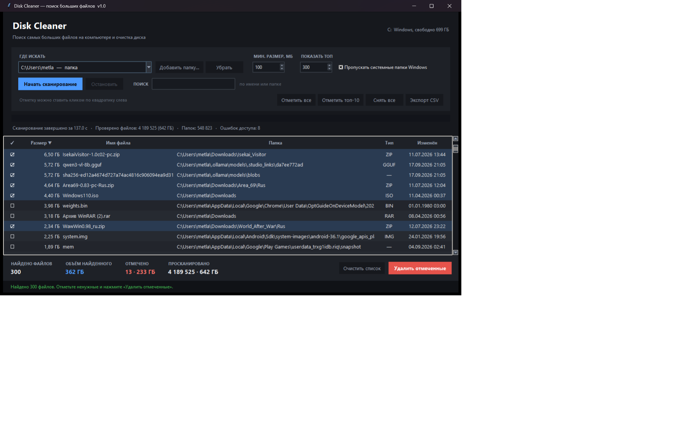
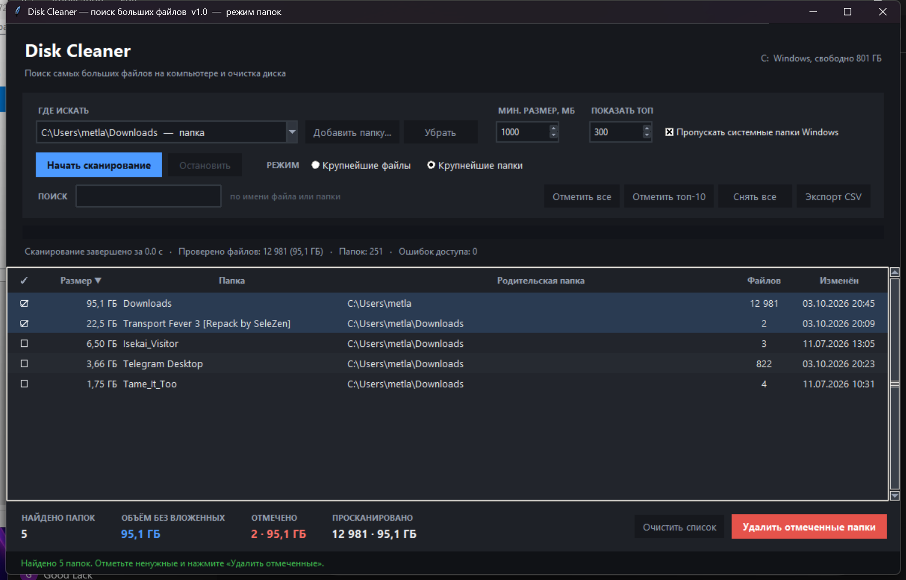

# Disk Cleaner

Программа для Windows, которая находит **самые большие файлы и папки** на диске и помогает
аккуратно избавиться от лишнего: по одному файлу или целыми папками, с предпросмотром
размеров и защитой от случайного удаления системного.



## Возможности

- **Два режима работы** — переключатель «Крупнейшие файлы» / «Крупнейшие папки».
  В режиме папок для каждой папки считается суммарный размер со всем содержимым,
  а удаление выполняется целиком вместе с вложенными папками и файлами.
- **Сканирование всего компьютера** — все локальные диски сразу, отдельный диск или
  любая добавленная вручную папка.
- **Фоновое сканирование** — интерфейс не подвисает, прогресс, текущая папка, скорость
  и счётчик ошибок доступа обновляются в реальном времени; есть кнопка «Остановить»,
  частичный результат остаётся в таблице.
- **Фильтры** — минимальный размер в мегабайтах, «показать топ-N» и живой поиск по
  имени файла или папки.
- **Таблица с отметками** — клик по квадратику слева отмечает объект, сортировка по
  любой колонке, кнопки «Отметить все», «Отметить топ-10», «Снять все», `Ctrl+A`.
- **Удаление** — по умолчанию в **Корзину** (файлы и папки можно восстановить),
  отдельной кнопкой — безвозвратно. Перед удалением всегда показывается подтверждение
  с количеством объектов и суммарным объёмом.
- **Экспорт в CSV** — список вместе с отметками сохраняется в файл, который открывается
  в Excel (кодировка `utf-8-sig`, разделитель `;`).
- **Контекстное меню** по правой кнопке — открыть расположение файла в Проводнике,
  открыть сам файл, скопировать путь. Двойной клик по строке тоже открывает Проводник.



## Безопасность

Отметить и удалить нельзя:

- системные файлы: `pagefile.sys`, `hiberfil.sys`, `swapfile.sys`, `DumpStack.log.tmp`,
  `bootmgr`, `ntldr`, `boot.ini`;
- содержимое системных папок: `C:\Windows`, `Program Files`, `Program Files (x86)`,
  `ProgramData`, `$Recycle.Bin`, `System Volume Information`, `Recovery`, `Boot`,
  `PerfLogs`, `MSOCache`;
- корни дисков (`C:\`, `D:\`) и профиль пользователя вместе со всеми его родителями
  (`C:\Users\<имя>` нельзя снести одним кликом);
- при удалении папок вложенные отмеченные папки схлопываются: если отмечены и родитель,
  и папка внутри него, удалится только родитель, а объём не будет посчитан дважды.

Такие строки помечены значком 🔒, а попытка их отметить выводит пояснение в строке
состояния. Содержимое `C:\$Recycle.Bin` также защищено — корзину очищайте штатным
средством Windows.

## Требования

- Windows 10 или 11;
- Python 3.8+ (проверено на 3.14) со стандартным `tkinter`;
- никаких сторонних библиотек — только стандартная библиотека Python.

## Запуск

Двойной клик по `Запустить Disk Cleaner.bat` (окно откроется без консоли) либо:

```powershell
python disk_cleaner.py
```

## Консольный режим

Если нужно быстро получить список без интерфейса:

```powershell
# топ-30 файлов больше 200 МБ на диске C:
python disk_cleaner.py --cli C:\ --min-size-mb 200 --top 30

# крупнейшие папки всего компьютера
python disk_cleaner.py --all-drives --folders --min-size-mb 500

# справка
python disk_cleaner.py --help
```

| Ключ | Значение |
|---|---|
| `--cli PATH` | папка или диск для сканирования (без аргумента — все диски) |
| `--all-drives` | сканировать все локальные диски |
| `--folders` | искать крупнейшие папки, а не файлы |
| `--min-size-mb N` | минимальный размер объекта, МБ (по умолчанию 100) |
| `--top N` | сколько строк показать (по умолчанию 30) |
| `--smoke` | проверка, что интерфейс собирается без ошибок |

## Как это работает

- Обход дерева каталогов идёт через `os.scandir` в отдельном потоке; точки повторной
  обработки (junction, symlink) пропускаются, чтобы не ходить по кругу и не считать
  одно и то же дважды.
- **Файлы**: размеры берутся из кэша `scandir`, а в памяти держится min-heap только на
  top-N самых больших файлов — потребление памяти не зависит от числа файлов на диске.
- **Папки**: обход в глубину с пост-обработкой (post-order). Размер папки складывается
  из размеров её файлов и уже посчитанных подпапок, а незакрытые кадры обхода хранят
  только текущую ветку — память O(глубины дерева), а не O(числа папок). Это позволяет
  считать размеры сотен тысяч папок без роста памяти.
- Ошибки доступа (`PermissionError` и прочие `OSError`) не прерывают сканирование,
  а считаются и показываются отдельным счётчиком — на системном диске их обычно сотни.
- Удаление в Корзину выполняется через Shell API (`SHFileOperationW` с флагом
  `FOF_ALLOWUNDO`), безвозвратное — через `os.remove` и `shutil.rmtree`.

Замер на реальном диске: `C:\` — 5 129 382 файла, 727 412 папок, 1,44 ТБ; полный обход
в режиме файлов занял около 13 минут, 573 ошибки доступа обработаны без сбоев.
С включённой галочкой «Пропускать системные папки Windows» сканирование заметно быстрее.

## Ограничения

- Только Windows: определение дисков, тёмный заголовок окна и удаление в Корзину
  используют Win32 API.
- Чтобы удалить файлы в чужих системных папках, программу нужно запустить от имени
  администратора — иначе такие объекты попадут в отчёт «не удалось удалить».
- Отправка в Корзину больших объектов (десятки гигабайт) может занимать время и требует
  свободного места на диске под саму корзину.

## Лицензия

MIT — см. [LICENSE](LICENSE).
